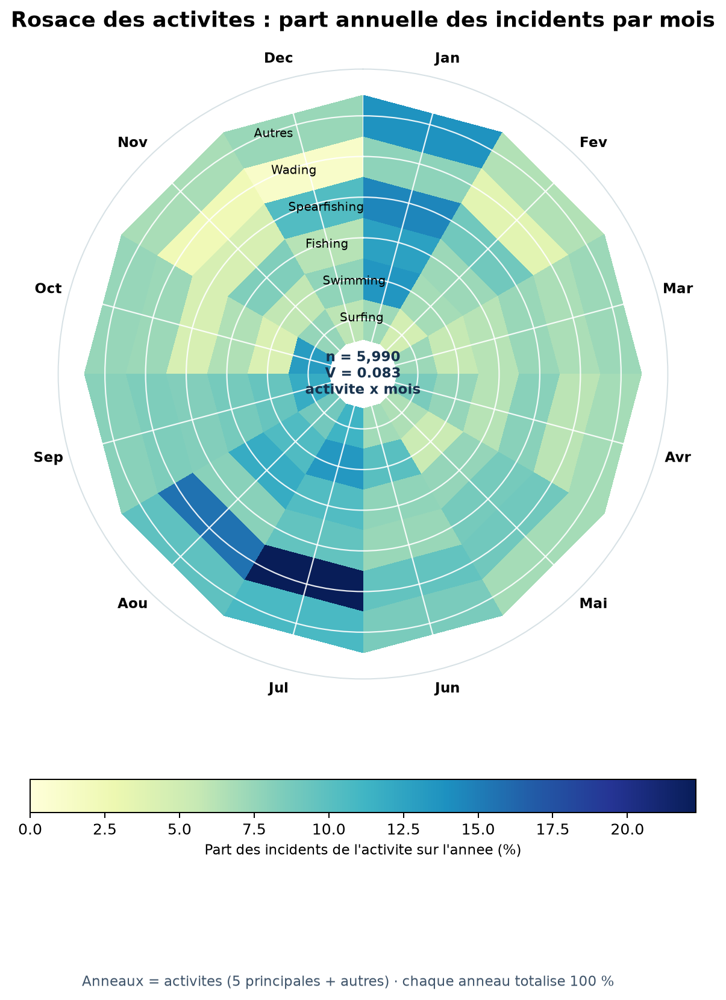

# Activites et saisonnalite des incidents declares

L'analyse porte sur 6516 incidents ayant une date exploitable. 5990 ont aussi une activite connue et non vide.

## Association descriptive

Le V de Cramer entre le mois et l'activite (5 activites les plus frequentes + « Autres ») est de **0.083**. C'est une association faible dans ce regroupement, sans controle de l'annee, du pays, de l'hemisphere ni de la frequentation humaine. Ce coefficient descriptif ne prouve ni causalite ni niveau de risque.

## Sensibilite des dates au 1er janvier

347 dates (5.3 % des dates exploitables) sont enregistrees au 1er janvier. Le projet ne possede pas de champ de precision de date permettant de distinguer une date exacte d'une date partielle representee ainsi. Le mois le plus compte est **Jan** avec toutes les dates, contre **Jul** si l'on exclut ces lignes. Cette exclusion est une sensibilite, pas une correction des donnees.

Le V de Cramer passe de 0.083 a 0.080 dans cette sensibilite.

## Lecture du visuel

Chaque anneau represente une activite (les cinq plus frequentes, puis les autres); ses douze secteurs montrent la part annuelle de cette activite pour chaque mois. Les anneaux sont normalises separement : la couleur compare la saisonnalite d'une activite, pas son volume avec une autre activite. « Inconnue » est exclue.

## Conclusion prudente

Les activites declarees et les incidents varient selon les mois, mais les donnees ne contiennent pas le nombre de personnes exposees, le temps passe dans l'eau, une position GPS precise, ni une mesure coherente de l'effort de signalement. On ne peut donc pas deduire un risque individuel, une saison de danger universelle ou un effet biologique.

Les donnees GBIF disponibles sont traitees separement dans `ecological_hypotheses.md`; elles suggerent un chevauchement geographique, mais leurs dates recentes ne permettent pas de relier temporellement les occurrences aux attaques historiques.
